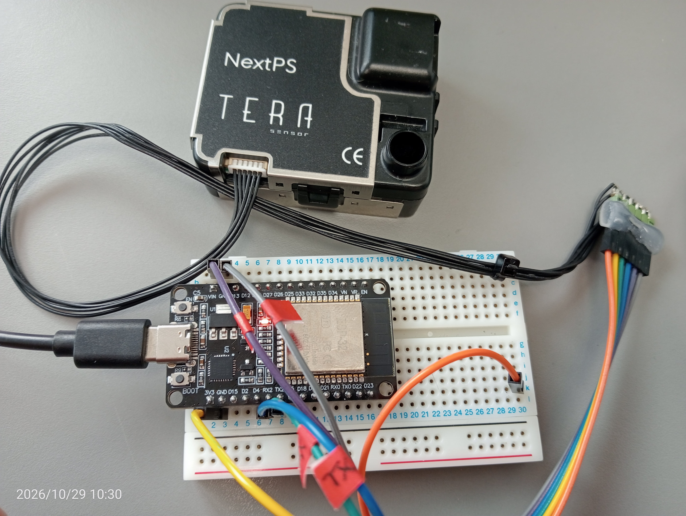

# TERA NextPM + ESP32 Real-Time Air Quality & Machine Learning Dashboards

An educational, interactive Python and C++ suite for streaming multi-channel particulate matter counts from a TERA NextPM sensor via an ESP32 microcontroller, coupled with real-time machine learning architectures built on CustomTkinter, Scikit-Learn, and Matplotlib.

## Hardware Architecture & Wiring



### Components

* TERA NextPM Particle Sensor (UART Interface)
* ESP32 Microcontroller Board (NodeMCU / ESP32 WROOM-32)
* Jumper Wires & 5V Power Supply

### Pin Connection Table

| TERA NextPM Pin | ESP32 Pin | Note | 
| --- | --- | --- | 
| VCC | 5V / VIN | 5V Power supply | 
| GND | GND | Common Ground | 
| TX | GPIO 16 (RX2) | HardwareSerial2 RX | 
| RX | GPIO 17 (TX2) | HardwareSerial2 TX | 

## Repository Structure

```text
├── README.md                           # Documentation and Guide
├── firmware/
│   └── NextPM_ESP32_Firmware.ino       # ESP32 C++ Arduino Sketch
└── dashboards/
    ├── NextPS_Dashboard.py            # Basic Real-Time Telemetry Stream
    ├── Gaussian_Mixture_Models.py     # Unsupervised GMM + 3D PCA Clustering
    ├── NextPS_Forecast_Dashboard.py   # Short-Term Linear Regression Forecast
    └── NextPS_Supervised3D_Dashboard.py # Supervised Activity Recognition (Random Forest)

Installation & Setup
Clone the Repository:

git clone [https://github.com/your-username/tera-nextpm-ml-dashboard.git](https://github.com/your-username/tera-nextpm-ml-dashboard.git)
   cd tera-nextpm-ml-dashboard

Install Python Dependencies:
pip install customtkinter pandas numpy scikit-learn matplotlib pyserial


Flash the ESP32 Firmware:

Open firmware/NextPM_ESP32_Firmware.ino in Arduino IDE.

Select your ESP32 board and COM port.

Upload the sketch. The ESP32 will sample the NextPM sensor every 2 seconds at 115,200 baud (8E1 configuration).


## Application Scripts & Demos

### 1. Basic Real-Time Telemetry Dashboard
* **Script:** `dashboards/NextPS_Dashboard.py`
* **Description:** Displays live real-time particle counts for all 5 particle channels (>0.3 µm, >0.5 µm, >1.0 µm, >2.5 µm, >5.0 µm) in a rolling 60-second window, along with descriptive statistics tools and raw CSV export.

### 2. Unsupervised GMM + 3D PCA Clustering
* **Script:** `dashboards/Gaussian_Mixture_Models.py`
* **Description:** Analyzes multi-channel particle size ratios on the fly using Gaussian Mixture Models (GMM) and Bayesian Information Criterion (BIC) to dynamically discover operational indoor air regimes without manual tagging. Visualized in an interactive, rotatable 3D PCA space.

### 3. Predictive Forecasting & Trajectory Space
* **Script:** `dashboards/NextPS_Forecast_Dashboard.py`
* **Description:** Applies rolling least-squares linear regression to project particle trajectories 10 seconds into the future (dashed lines). Tracks environmental velocity and plots a continuous 3D phase-space trajectory path.

### 4. User-Defined Supervised Activity Recognition
* **Script:** `dashboards/NextPS_Supervised3D_Dashboard.py`
* **Description:** Allows users to type custom activity labels (e.g., "Cooking", "Cleaning", "Idle"), record live training samples into RAM, and instantly train a Random Forest Classifier. Predicts active room activities in real-time with confidence scores and color-codes custom classes in 3D PCA space.

## Educational Guides & Scientific Background

Each advanced dashboard includes a built-in Educational Guide pop-up detailing:

* **Particulate Matter Physics:** How ultrafine particles ($>0.3\,\mu\text{m}$) correlate with combustion/cooking, while coarse particles ($>2.5\,\mu\text{m}$) correlate with physical movement or dust.
* **Dimensionality Reduction:** How Principal Component Analysis (PCA) reduces 6-dimensional feature vectors ($[\text{PM}_{0.3}, \text{PM}_{0.5}, \text{PM}_{1.0}, \text{PM}_{2.5}, \text{PM}_{5.0}, \text{Ratio}]$) into 3 orthogonal axes ($\text{PC1}, \text{PC2}, \text{PC3}$) for human visualization.
* **Machine Learning Fundamentals:** Explanations of Random Forest ensembles, GMM covariance structures, and linear regression derivatives.

## License

Distributed under the MIT License. See `LICENSE` for more information.
